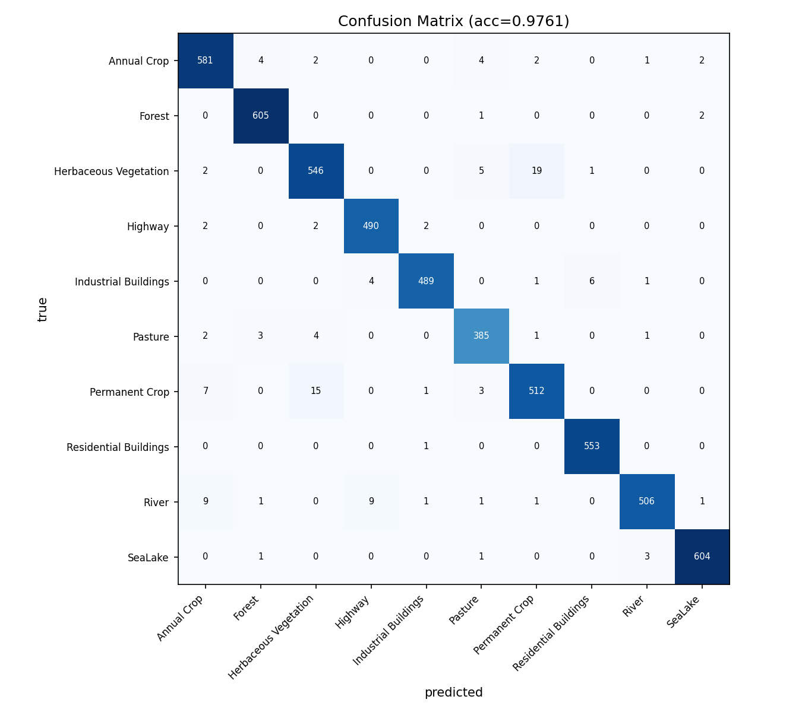

# EuroSAT 遥感地物分类

用 PyTorch 从零手写 ResNet18，对 EuroSAT 卫星影像做 10 类地物分类。测试集准确率 97.61%。

## 数据

EuroSAT RGB，共 27000 张 64×64 彩色图像，10 类（农田、森林、河流、住宅区、工业区等）。训练集 16200 张、验证集 5400 张、测试集 5400 张，按类别分层划分，各类别样本量 2000～3000。

## 方法

- 模型：自己实现的 BasicBlock 和 ResNet18，约 11.18M 参数。
- 适配小图：输入只有 64×64，主干改成 3×3 stride1 卷积，四个 stage 各下采样一次，最后特征图 4×4。
- 训练：SGD + OneCycleLR，交叉熵损失，30 epoch，Kaggle 免费 T4。
- 增强：随机水平/垂直翻转。
- 归一化用的均值和标准差从训练集统计得到。

## 结果

测试集 97.61%，验证集最高 97.30%。




各类别 P/R/F1 在 `results/metrics_resnet18.csv`。最低的是 Permanent Crop（F1 0.953）和 Herbaceous Vegetation（0.956），这两类和 Pasture 颜色纹理接近，容易混。

## 分析

- `docs/数据分析报告.md`：类别分布、混淆对、错分样本
- `docs/Grad-CAM可解释性分析.md`：Grad-CAM 热力图，看模型关注哪里
- `docs/迁移学习对照实验.md`：手写模型和预训练 ResNet18 的对比

迁移学习对比结果：

| 方案 | 测试准确率 | epoch |
|---|---|---|
| 手写 ResNet18 | 97.61% | 30 |
| 预训练微调 | 97.06% | 8 |
| 预训练冻结 + 线性头 | 91.46% | 60 |

## 目录

```
eurosat-classify/
├── src/
│   ├── data/           # 数据下载、划分、检查、画图
│   ├── models/         # BasicBlock 和 ResNet
│   ├── train.py        # 训练
│   ├── evaluate.py     # 测试集评估
│   ├── analyze.py      # 分析与错误分析
│   ├── gradcam.py      # Grad-CAM
│   ├── transfer.py     # 迁移学习对比
│   ├── infer.py        # 推理
│   ├── predict.py      # 命令行推理
│   └── serve.py        # FastAPI 服务
├── kaggle/kaggle_train.py  # Kaggle 上训练用的脚本
├── scripts/            # 辅助脚本
├── figures/            # 图
├── results/            # 指标、日志
└── docs/               # 文档
```

## 运行

```powershell
# 准备数据
python -m src.data.download
python -m src.data.split
python -m src.data.check
python -m src.data.figures

# 训练（本地 CPU 可用；完整训练在 Kaggle 上跑 kaggle/kaggle_train.py）
python -m src.train

# 评估
python -m src.evaluate --tag resnet18
```

推理服务：

```powershell
.\scripts\run_serve.ps1
```

浏览器打开 http://127.0.0.1:8001，上传图片返回类别和置信度。

也可以直接用命令行：

```powershell
python -m src.predict --image path/to/image.png
```

## 环境

虚拟环境、数据和缓存都放在 D 盘：

- `D:\eurosat\venv`：虚拟环境
- `D:\eurosat\data`：数据
- `D:\eurosat\cache`：缓存
- `D:\eurosat\results\resnet18_best.pt`：训练好的权重（没放进仓库）

```powershell
. .\scripts\env.ps1
uv venv D:\eurosat\venv --python 3.12
uv pip install --python D:\eurosat\venv\Scripts\python.exe -e .
```
