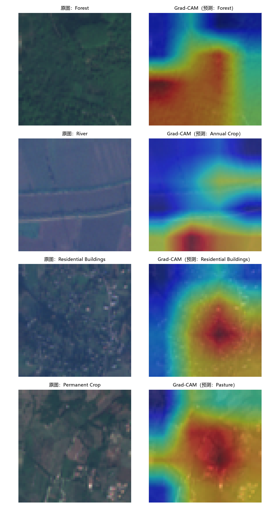
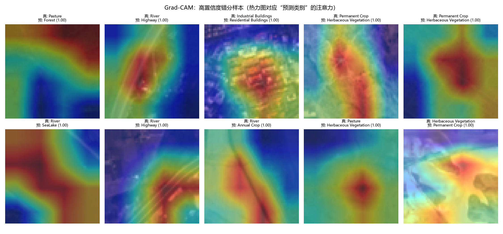
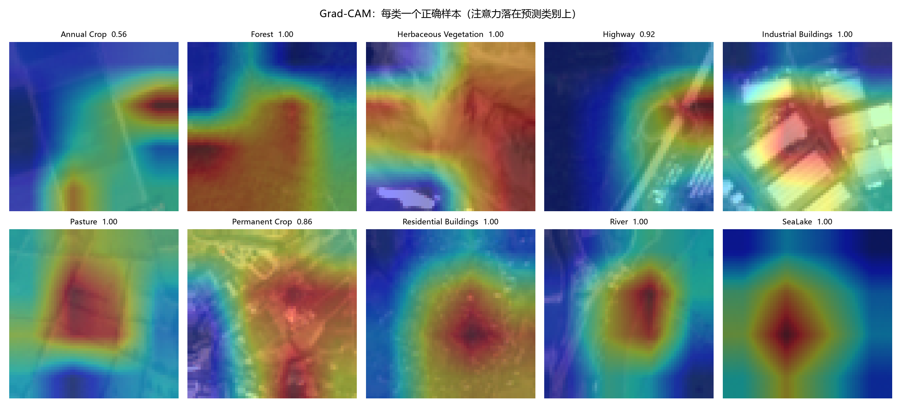

# Grad-CAM 可解释性分析

> 对应项目：[EuroSAT 遥感地物分类](../README.md)
> 模型：手写 ResNet18（测试集准确率 97.61%）

## 1. 这是什么

Grad-CAM（Gradient-weighted Class Activation Mapping）用来回答一个问题：**模型判断这张图属于某个类别时，到底在看图像的哪个区域？**

做法：取最后一层卷积（`layer4`）的特征图，对“目标类别的分数”求梯度，用梯度的全局平均作为权重对特征图加权求和，ReLU 后归一化，得到一张与输入同尺寸的热力图。红色=模型最关注的区域，蓝色=基本不看。

实现代码：[`src/gradcam.py`](../src/gradcam.py)（纯 PyTorch，不需要重新训练）。

## 2. 正确样本：模型看对了地方



- **Forest**：热力图集中在成片的林冠区域，符合直觉；
- **Residential Buildings**：热力图聚焦在建筑密集区；
- **River → Annual Crop（错例）**：热力图落在图下方的农田上，**完全没看那条河**——这正是它误判的原因；
- **Permanent Crop → Pasture（错例）**：热力图落在植被纹理区，说明两者在 64×64 下确实难以区分。

## 3. 错分样本：为什么错



热力图对应的是“预测类别”的注意力。可以看到几类系统性错误：

| 真实 → 预测 | 热力图关注区域 | 解释 |
|---|---|---|
| River → Annual Crop | 图中农田/河岸区域 | 河流与沿河农田同框，模型看了农田 |
| River → Highway | 图中的道路/线性地物 | 把线性地物误当成道路 |
| Industrial → Residential | 建筑密集区 | 低分辨率下厂房与住宅纹理接近 |
| Herbaceous → Permanent Crop | 规则植被纹理 | 两类植被纹理高度相似 |

这与 [`docs/数据分析报告.md`](数据分析报告.md) 中的混淆分析完全一致：**错误主要来自视觉相似，而不是样本不均衡**。

## 4. 每类样本注意力总览



## 5. 局限与可改进点

- 我们的网络经过 4 个 stride-2 stage，`layer4` 特征图只有 **4×4**，所以热力图比较粗（上采样到 64×64 后偏“块状”）。
- 想要更精细的定位，可以把 Grad-CAM 的目标层换成 `layer3`（8×8）或 `layer2`（16×16），代价是语义性稍弱。
- 另一个改进方向是 Grad-CAM++ / Score-CAM，能更稳定地定位小目标（如河流）。

## 6. 产出文件

- `figures/gradcam_per_class.png`：每类一个正确样本的热力图
- `figures/gradcam_errors.png`：高置信度错分样本
- `figures/gradcam_samples.png`：原图 vs 热力图（代表样本）
- `results/gradcam_meta.csv`：生成样本清单

## 7. 复现

```powershell
python -m src.gradcam
```
