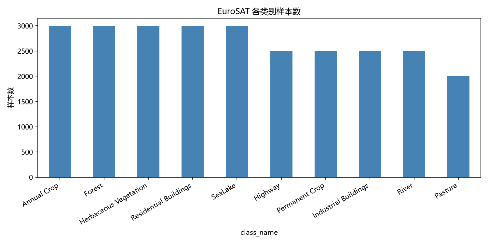
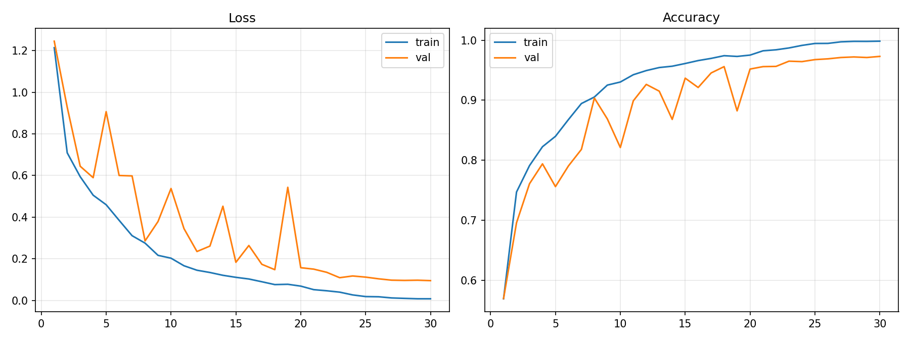
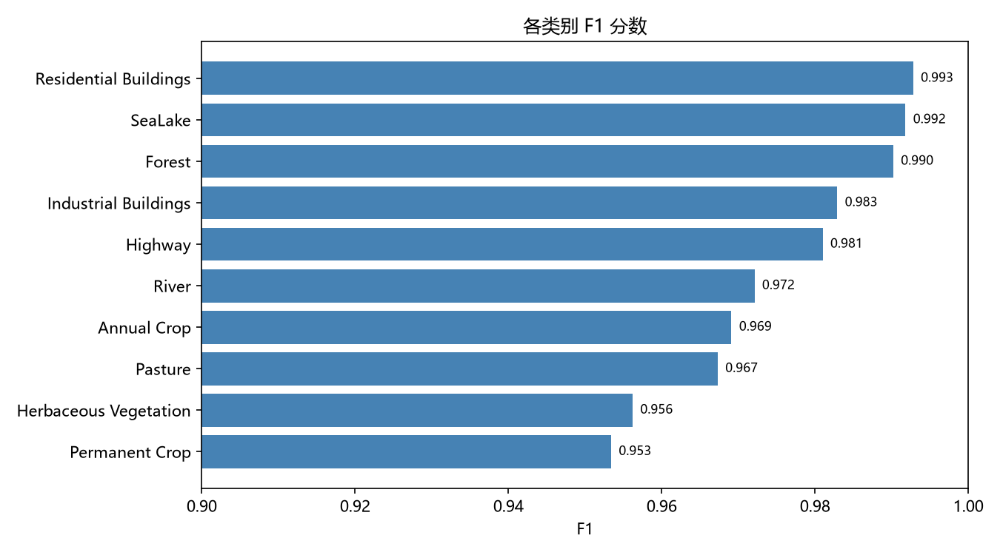
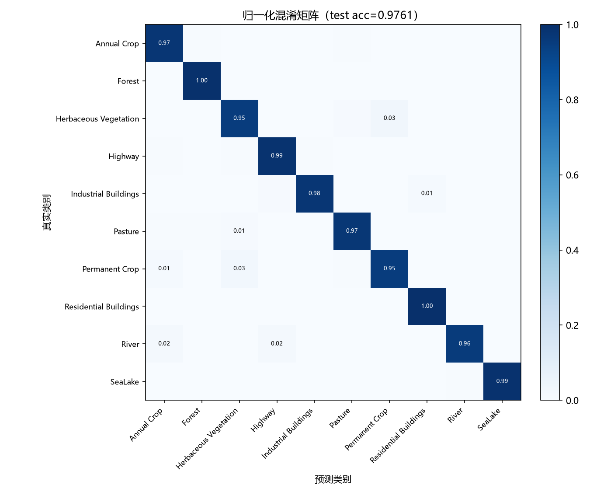
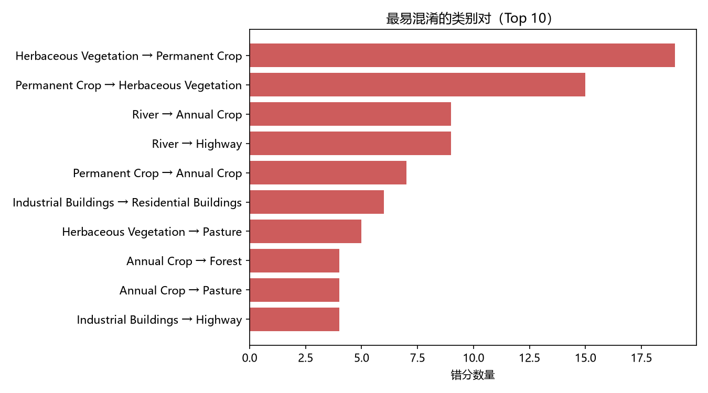
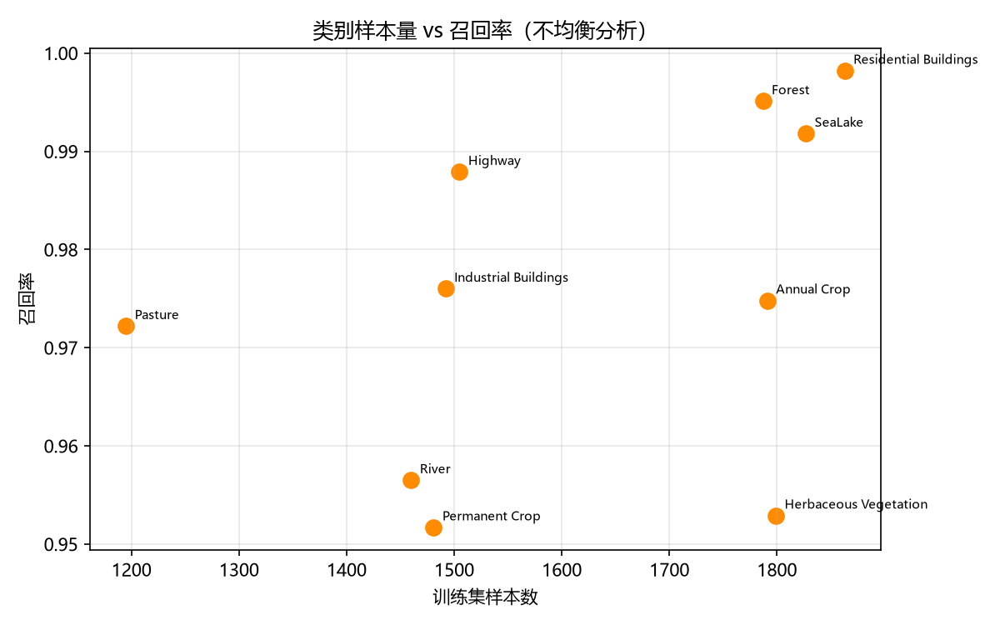
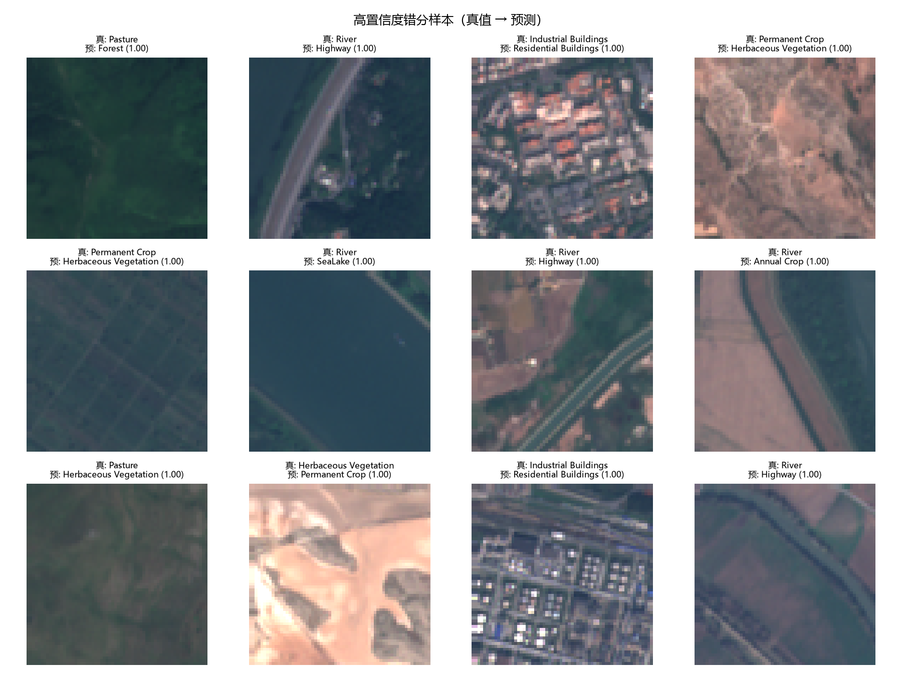

# 数据分析与错误分析报告

> 项目：[EuroSAT 遥感地物分类 · 手写 ResNet](../README.md)
> 模型：手写 ResNet18（11.18M 参数，从零训练）
> 测试集：5,400 张

## 1. 数据概览

| 项目 | 数值 |
|---|---|
| 样本总数 | 27,000 |
| 训练 / 验证 / 测试 | 16,200 / 5,400 / 5,400 |
| 图像尺寸 | 全部 64×64×3 |
| 类别数 | 10 |
| 类别样本量 | 5 类 ×3000、4 类 ×2500、Pasture ×2000 |
| 不均衡比 max/min | **1.5** |
| 训练集归一化 | mean = (0.2118, 0.1924, 0.1979)，std = (0.1980, 0.1771, 0.1787) |

数据完整性检查：像素范围 [0,255]、无缺失值、无损坏文件（`python -m src.data.check`）。

## 2. 总体结果

| 指标 | 值 |
|---|---|
| **测试集准确率** | **97.61%** |
| 最佳验证集准确率 | 97.30% |
| 训练集准确率（末轮） | 99.83% |

训练与验证差距约 2.5 个百分点，属于**轻微过拟合**，但在可接受范围内。

## 3. 每类指标

| 类别 | Precision | Recall | F1 | 测试样本数 |
|---|---|---|---|---|
| Residential Buildings | 0.9875 | 0.9982 | **0.9928** | 554 |
| SeaLake | 0.9918 | 0.9918 | 0.9918 | 609 |
| Forest | 0.9853 | 0.9951 | 0.9902 | 608 |
| Industrial Buildings | 0.9899 | 0.9760 | 0.9829 | 501 |
| Highway | 0.9742 | 0.9879 | 0.9810 | 496 |
| River | 0.9883 | 0.9565 | 0.9721 | 529 |
| Annual Crop | 0.9635 | 0.9748 | 0.9691 | 596 |
| Pasture | 0.9625 | 0.9722 | 0.9673 | 396 |
| Herbaceous Vegetation | 0.9596 | 0.9529 | 0.9562 | 573 |
| Permanent Crop | 0.9552 | 0.9517 | **0.9534** | 538 |

最弱两类是 **Permanent Crop（0.9534）** 和 **Herbaceous Vegetation（0.9562）**。

## 4. 混淆分析

最易混淆的类别对（Top 10）：

| 真实类别 | 预测类别 | 错分数量 | 占该类比例 |
|---|---|---|---|
| Herbaceous Vegetation | Permanent Crop | 19 | 3.32% |
| Permanent Crop | Herbaceous Vegetation | 15 | 2.79% |
| River | Annual Crop | 9 | 1.70% |
| River | Highway | 9 | 1.70% |
| Permanent Crop | Annual Crop | 7 | 1.30% |
| Industrial Buildings | Residential Buildings | 6 | 1.20% |
| Herbaceous Vegetation | Pasture | 5 | 0.87% |
| Annual Crop | Forest | 4 | 0.67% |
| Annual Crop | Pasture | 4 | 0.67% |
| Industrial Buildings | Highway | 4 | 0.80% |

## 5. 关键结论：错误来自“视觉相似”，不是“样本不均衡”

具体情况如下：

- **样本最少的 Pasture（训练 1200 张）召回率却有 0.972**；
- 相反，样本更多的 **Herbaceous Vegetation / Permanent Crop（训练各 1800 张）反而召回率最低（0.953 / 0.956）**。

也就是说，1.5 倍的类别不均衡**不是**主要瓶颈；真正的瓶颈是**几类地物在 64×64 分辨率下视觉特征高度重叠**：

1. **植被类混淆（Herbaceous ↔ Permanent Crop ↔ Pasture）**：都是绿色/黄绿色植被，纹理季节差异小；
2. **水域-道路混淆（River → Highway / Annual Crop）**：河流常与沿河道路、农田同框，出现“线性地物”主导判断；
3. **建成区混淆（Industrial → Residential）**：都是建筑密集区，64×64 下厂房与住宅的尺度/纹理差别有限。

## 6. 高置信度错分样本

从错分样本看，模型大多是“**有理有据地错**”（置信度接近 1.0），例如：

- `River → Highway`：图中确实有一条贯穿的主干道，河流只占一角；
- `Industrial Buildings → Residential Buildings`：厂房与住宅区在低分辨率下纹理接近；
- `Permanent Crop → Herbaceous Vegetation`：两者都是规则农田/草地纹理。

这类错误单靠加深网络收效有限，需要**更多判别性信息**（多光谱/时序、纹理特征）或**标签体系上的细分**。

## 7. 改进建议

| 方向 | 具体做法 |
|---|---|
| 缓解植被混淆 | 引入 NDVI 等植被指数（EuroSAT 有多光谱版本），或增加颜色扰动/纹理增强 |
| 缓解建成区混淆 | 提高输入分辨率（如 128×128）或加大模型感受野 |
| 缓解线性地物混淆 | 测试时增强（TTA）、多尺度推理 |
| 训练策略 | Label Smoothing / Mixup / 余弦退火 / 更长训练 |
| 类别权重 | 对植被三类做类平衡采样（虽然本次不均衡影响不大，仍可验证） |

## 8. 产出文件

- 每类指标：`results/analyze_metrics.csv`
- 预测明细：`results/analyze_predictions.csv`
- 混淆对：`results/analyze_top_confusions.csv`
- 汇总：`results/analyze_summary.json`
