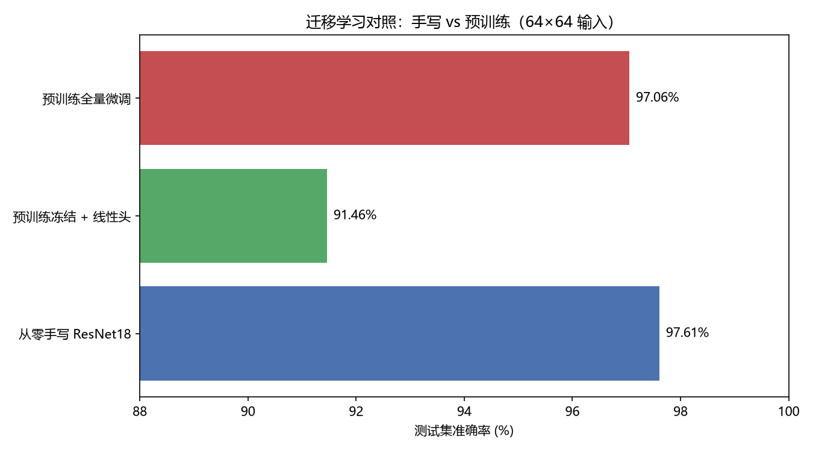
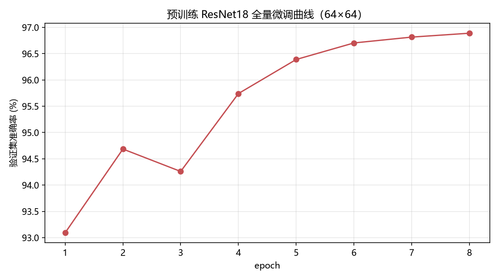

# 迁移学习对照实验

> 项目：[EuroSAT 遥感地物分类](../README.md)
> 目的：对比预训练模型和手写模型在同一任务上的表现。

## 1. 实验设置

三组方案，**同一份数据、同一个测试集（5400 张）、同样 64×64 输入**：

| 组 | 方案 | 说明 |
|---|---|---|
| A | 从零手写 ResNet18 | 已有基线，Kaggle T4 训练 30 epoch |
| B | 预训练冻结 + 线性头 | 加载 ImageNet 预训练 ResNet18，冻结全部卷积层，只训练最后线性分类头 |
| C | 预训练全量微调 | 加载 ImageNet 预训练权重，整个网络微调 8 epoch |

- 预训练权重：`torchvision` 的 `ResNet18_Weights.IMAGENET1K_V1`
- B/C 使用 ImageNet 标准归一化（mean/std），A 使用数据自身统计量
- 训练设备：A 为 Kaggle T4；B/C 为本地 CPU（B 做特征提取 + 线性训练，C 做 8 epoch 微调）

## 2. 结果

| 方案 | 测试准确率 | 最佳验证准确率 | 训练 epoch | 训练耗时 | 设备 |
|---|---|---|---|---|---|
| **A. 从零手写 ResNet18** | **97.61%** | 97.30% | 30 | 565s | Kaggle T4 |
| C. 预训练全量微调 | 97.06% | 96.89% | **8** | 1451s | CPU |
| B. 预训练冻结 + 线性头 | 91.46% | 90.96% | 60（线性层） | 80s | CPU |





## 3. 结论

### ① 冻结主干 + 线性头（91.46%）：迁移有效但不够

只用 ImageNet 特征 + 一个线性分类器，能到 91.46%，说明预训练特征确实“有东西”；但和 97% 差了一大截——**ImageNet（自然图像）和遥感图像域差异大，特征需要适配，光靠线性头不够**。

### ② 全量微调（97.06%）：收敛快，但没能超过手写模型

- **收敛速度优势明显**：微调 **8 个 epoch** 就到 96.89%（验证），而从零训练要到约 20+ epoch 才到同等水平。
- **最终精度**：97.06% vs 手写 97.61%，**手写模型略胜 0.55 个百分点**。

### ③ 为什么“从零训练”反而略好？——关键在于输入尺度

原因主要在输入尺度：

- 预训练 ResNet18 的主干是为 **224×224** 设计的：`7×7 conv stride2 + maxpool` 会把 64×64 直接砍到 **16×16**，到 `layer4` 只剩 **2×2**，空间信息损失很大；
- 手写模型专门为小图改了主干（`3×3 stride1`、4 个 stage 各下采样一次），在 64×64 上保住了更多细节，**结构更适配任务**；
- 所以在这个“小图 + 小数据集 + 与 ImageNet 差异大”的场景下，**领域适配的网络结构 + 充分训练，可以追平甚至略超预训练迁移**。

## 4. 实践建议

| 场景 | 推荐方案 |
|---|---|
| 数据少、算力有限、想快速出结果 | **全量微调**（8 epoch 就能到 ~97%） |
| 追求极致精度、有时间调结构 | **从零训练 + 针对输入尺寸设计主干** |
| 只想验证特征质量、做快速基线 | 冻结主干 + 线性头（80 秒能出 91%） |
| 预训练要发挥全部实力 | 把输入上采样到 **224×224** 再微调（本次未做） |

## 5. 局限

1. 预训练模型用 64×64 输入，未发挥其原生 224 尺度优势；若上采样到 224，微调结果大概率更高。
2. A 组在 GPU、C 组在 CPU 训练，耗时不可直接比较；精度对比仍有效（同数据同测试集）。
3. 只对比了 ResNet18，未试 ResNet50 / EfficientNet 等更大骨干。

## 6. 复现

```powershell
# 本地 CPU 跑 B + C（约 25 分钟；GPU 会快很多）
python -m src.transfer --img-size 64 --epochs 8

# 仅重新生成对比图
python scripts/plot_transfer.py
```

产物：`results/transfer_results.json`、`results/transfer_log.csv`、`figures/transfer_compare.png`、`figures/transfer_curves.png`。
